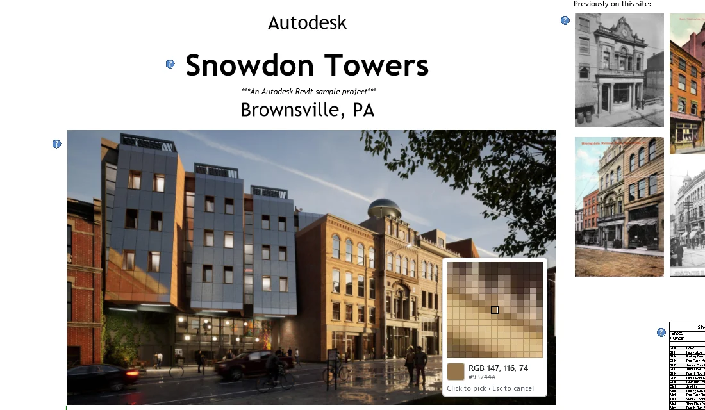

# Pick-It

**Pick-It** is a Revit add-in by [Designs/OS](https://designs-os.com) for picking a colour and showing its RGB values directly on the ribbon button.

**[Project website →](https://pick-it.designs-os.com/)**

## What it does

1. Click **Pick-It** on Revit's **Add-Ins** tab.
2. Click any pixel on any monitor. A magnifier shows exactly which pixel you are about to pick; Esc or right-click cancels.
3. The Pick-It icon turns into that colour and shows its R, G and B values. It stays that way, across Revit sessions, until you pick again or clear it.

**Shift-click** the button for the menu:

- **Recent colours**: your last 10 picks. Click one to make it the current colour.
- **Clear** and **Clear history**.
- **Add to palette…**: puts the current colour into one of the 16 custom-colour slots of Revit's own Color dialog, so it is there the next time you set a colour anywhere in Revit.

## Install

Download `PickIt-<version>.msi` from the [latest release](https://github.com/jedbjorn/pick-it/releases/latest) and run it. It installs for the current user, needs no administrator rights, and adds Pick-It to every supported Revit version it finds. Restart Revit afterwards.

Releases after v1.0.0 are digitally signed by **AnJ Arch-Tech LLC**, the company behind Designs/OS. To check, right-click the MSI and choose **Properties › Digital Signatures**: the signer is AnJ Arch-Tech LLC, with a timestamp. If Windows says "Windows protected your PC", choose **More info**: the publisher must read AnJ Arch-Tech LLC (v1.0.0: unknown, it is unsigned), then **Run anyway**. If Revit asks whether to load Pick-It, choose **Always Load**.

## Compatibility

Revit 2025, 2026 and 2027 on Windows, matching [Gantt-It](https://github.com/jedbjorn/gantt-it). Older versions of Revit are not planned.

## Learn more

The intended interaction and the shared Designs/OS design language are in the [product and design brief](docs/DESIGN.md).

## More projects

Other open-source projects by the same author:

- **[Gantt-It](https://gantt-it.designs-os.com/)** — a Revit add-in that draws Gantt charts inside your Revit project, ready to place on your sheets. ([source](https://github.com/jedbjorn/gantt-it))
- **[FAI Browser](https://fai-browser.designs-os.com/)** — lets a coding agent work in one browser tab you approve, with permission levels, secret redaction and compact page summaries. ([source](https://github.com/jedbjorn/fai-browser))
- **[Subfloor](https://subfloor.designs-os.com)** — a standing team of coding agents for your Git repository, with durable identity, memory, specs and handoffs, run through your coding harness. ([source](https://github.com/jedbjorn/subfloor))
- **[RST](https://rst-c.designs-os.com/)** — a native Revit add-in for curated ribbon profiles: admins build them, users load them with one click. ([source](https://github.com/jedbjorn/rst-c))
- **[Splash-It](https://splash-it.designs-os.com/)** — a Revit add-in that colors view tabs by file, so open models and families are easy to tell apart. ([source](https://github.com/jedbjorn/splash-it))
- **[md-converter](https://md-converter.designs-os.com)** — a static web app that renders themed Markdown into styled, shareable HTML. ([source](https://github.com/jedbjorn/md-converter))
- **[Storybench](https://github.com/jedbjorn/storybench)** — a local workspace for developing videos with an AI production agent.
- **[AnJ Cloud](https://anj-cloud.designs-os.com/)** — household file sync from a gateway you host yourself, with clients for Linux, macOS, Windows and Android. ([source](https://github.com/jedbjorn/anj-cloud))

## License

Pick-It is released under the [MIT License](LICENSE). Copyright (c) 2026 Designs/OS.

---

For developers: the repository layout and build configurations are in [docs/DEVELOPING.md](docs/DEVELOPING.md).
